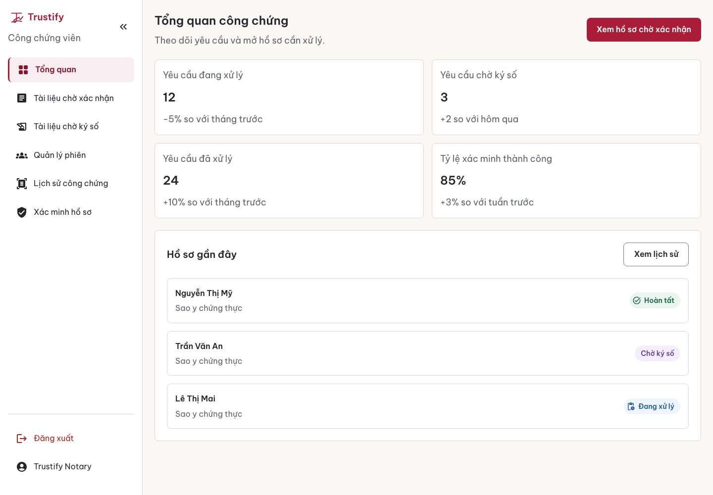

<div align="center">


### Hồ sơ rõ ràng. An tâm từng bước.

Online notarization (công chứng trực tuyến) for Vietnamese individuals, businesses and notary offices. Documents are reviewed by a notary, signed digitally and recorded on the Solana blockchain.

[](https://github.com/sloweyyy/Trustify-Frontend/actions/workflows/ci.yml)
[](https://trustify-notary.vercel.app)
[](LICENSE)

**[Live app](https://trustify-notary.vercel.app)** · **[Backend](https://github.com/sloweyyy/Trustify-Backend)** · **[Brand](docs/brand/brand-identity.md)** · **[Design system](docs/design-system.md)** · **[Pitch deck](https://www.canva.com/design/DAGnFWahmVs/YdtYLPQEpEvYkGgjJCtqpg/view)**

</div>

<p align="center">
  
  &nbsp;
  
</p>

## Contents

- [What it does](#what-it-does)
- [Try it](#try-it)
- [Tech stack](#tech-stack)
- [Getting started](#getting-started)
- [Project structure](#project-structure)
- [Design system](#design-system)
- [Deployment and CI](#deployment-and-ci)
- [Contributing](#contributing)

## What it does

| Role | Main screens |
|---|---|
| **Public** | Home, notary services and pricing, look up or verify a hồ sơ, sign in/up (email or Google), policy pages, AI assistant |
| **User** | Step-by-step **Tạo hồ sơ công chứng** wizard, history with status and payment, multi-party **phiên công chứng** (sessions), drawing a signature, **ví tài liệu** (NFT document wallet) with share and purchase, profile |
| **Notary** | Workload overview, queues for documents awaiting review and signature, side-by-side document review with accept/reject, session review, history |
| **Admin** | Metrics dashboard, employee, user and notary management, settings |

Every hồ sơ moves through the same lifecycle, shown with the same labels everywhere:

**Chờ xử lý → Đang xử lý → Chờ ký số → Hoàn tất** (or **Bị từ chối**). After payment, the notarized document is minted as an NFT and appears in the user's ví tài liệu.

## Try it

The QA environment is live at **https://trustify-notary.vercel.app**. The API runs on a free plan and sleeps when idle, so the first request can take about a minute.

| Role | Email | Password |
|---|---|---|
| User | `trustify.user@example.com` | `Trustify@123` |
| Notary | `trustify.notary@example.com` | `Trustify@123` |
| Admin | `trustify.admin@example.com` | `Trustify@123` |

> Payments go through a real PayOS checkout, and NFTs are minted on **Solana devnet** (test network).

## Tech stack

| | |
|---|---|
| UI | React 18, Create React App 5, MUI v6 (with `@mui/x-data-grid` and `@mui/x-date-pickers`), Be Vietnam Pro |
| State and routing | Redux Toolkit, React Router 6 |
| Data | Axios with token refresh, Chart.js |
| Tests | Jest, React Testing Library |
| Hosting | Vercel |

## Getting started

**Requirements:** Node.js 20 and a running [Trustify backend](https://github.com/sloweyyy/Trustify-Backend), local or the hosted QA API.

```bash
git clone https://github.com/sloweyyy/Trustify-Frontend.git
cd Trustify-Frontend
npm ci
cp .env.example .env
npm start            # http://localhost:3000
```

Set the backend URL in `.env`. It must include `/v1` and have no trailing slash:

```bash
# Local backend (run it on a port other than 3000, e.g. PORT=3100)
REACT_APP_API_BASE_URL=http://localhost:3100/v1

# Or use the hosted QA API
REACT_APP_API_BASE_URL=https://trustify-api-ar4i.onrender.com/v1
```

| Command | What it does |
|---|---|
| `npm start` | Development server with hot reload |
| `CI=false npm run build` | Production build into `build/` (`CI=false` because the existing lint warnings would otherwise fail the build) |
| `npm test` | Jest in watch mode; `CI=true npm test -- --watchAll=false` runs once |
| `npx eslint <files>` | Lint the files you changed |

## Project structure

```
src/
├── App.js                # Routes, theme provider, app shell
├── components/           # Shared UI (shell, dialogs, cards, status chips, signature pad…)
│   └── shared/           # Design-system primitives: DocumentStatusChip, PageFeedback, SignaturePad…
├── pages/                # Screens by area: admin/, notary/, services/ (user), signin/, static/…
├── services/             # API clients (one file per backend resource)
├── stores/               # Redux Toolkit slices and actions
├── config/theme/         # Design tokens (tokens.json) and MUI v6 overrides
├── routes/               # Public/private/payment route guards
└── utils/                # Constants, documentStatus, formatVnd…
docs/
├── brand/                # Brand identity, approved logo B, audit
├── design-system.md      # Tokens, components, screen specs
└── design/               # Revamp progress log and before/after screenshots
```

## Design system

The UI follows an approved brand and design system built for Vietnamese users: plain Vietnamese labels, one primary action per screen, step-by-step forms, and burgundy `#AA1D39` on warm neutrals.

- **[Brand identity](docs/brand/brand-identity.md)**: positioning, voice (addressing users as "bạn"), logo, colour, typography.
- **[Design system](docs/design-system.md)**: tokens, MUI component mapping, per-role screen specs, accessibility rules.
- **[Revamp progress](docs/design/PROGRESS.md)**: PR-by-PR implementation log.

When building UI, use theme tokens (`theme.palette`, `theme.trustify.*`) and the shared components in `src/components/shared/` rather than hard-coded colours or `sx` values.

## Deployment and CI

- **Hosting:** Vercel project `trustify-notary`. `main` deploys to production, and every PR gets a preview. `vercel.json` sets the build command and SPA rewrites. Set `REACT_APP_API_BASE_URL` in the Vercel project settings.
- **CI:** `.github/workflows/ci.yml` installs and builds every PR. GitGuardian scans every PR for secrets.

## Contributing

1. Branch from `main` and keep each PR focused.
2. Don't change API contracts here. They live in the [backend](https://github.com/sloweyyy/Trustify-Backend).
3. Make sure `CI=false npm run build` passes, and include before/after screenshots for UI changes.

## License

[MIT](LICENSE)
