# Design 02 — Shared document statuses and filters

Base: merged PR #10 (`227606e4ea568309b46e19034975b483d910be48`), whose primary Vercel production deploy reached Ready and live `/` returned HTTP 200 with no page errors.

This is the first small slice of stage 02, not the entire shared-component migration. A single display dictionary now supplies the theme and shared chips. The five lifecycle labels, colors and icons agree across the touched User history, Notary dashboard/history and Admin document grid. Verification remains a separate raw state and filter, displayed as Đang xử lý with Bước xác minh. Session readyToSign remains separate.

Existing translated filter keys are deliberately retained; the adapter changes their visible labels. Table search also accepts the newly visible labels. Raw response objects, permissions, callbacks, filter values/sorting/pagination state and service calls are unchanged. The Admin grid now recognizes raw rejected records as well as its legacy invalid alias; previously its label map omitted rejected. Search fields in the touched lists no longer autofocus. New text uses the approved 400/600 faces.

## Validation

- `CI=false npm run build`: passed; [log](build.log).
- `ESLINT_USE_FLAT_CONFIG=false npx eslint` on all changed JS: passed using existing CRA config; [log](eslint.log).
- 30 tests: shared chip states, unknown/session-state handling, legacy filter callback values, verification separation, actual table filtering/searching, and theme regression tests; [log](tests.log).
- Real QA account browser checks on local app: User history filters/search; Notary history filters (six records → two awaiting signature or two completed); Admin grid filters; no initial list autofocus or uncaught errors. Stable MUI toolbar slots preserve input/filter focus across updates in both Admin grids. [Results](browser-checks.json).
- [Admin GET-fixture checks](admin-fixture-checks.json) prove raw rejected/invalid matching and separate processing/verification/signature filters, without creating records.
- [Vercel QA checks](vercel-qa.json): final source deployment Ready; all three QA logins and role navigation/filtering passed. Both Admin searches retain focus through typing and filtering. The eight `vercel-*.png` images below show the deployed build. No payment or document/account changes.

## Boundaries

Legacy detail dialogs and other role-specific statuses migrate in their owning PRs. Responsive shells/table cards, empty/loading/error compositions, forms/dialogs/toasts, upload and stepper remain in the stage 02/03 queue. Existing mobile page overflow is visible in the captures. The Admin session grid’s empty pagination currently renders invalid counts; this pre-existing presentation issue will be addressed with the Admin grid. No new dependency or backend change.

## Before and after

Baseline is production main after PR #10; after is the local branch, using the same QA API. Desktop uses 1440px full-page capture. Mobile uses a real 390×844 viewport capture (`fullPage: false`); horizontal overflow is recorded separately in the manifests. The legacy permanent sidebar and wider table remain visible limitations until the shell/responsive-table PRs. [Pixel-width checks](image-dimensions.json) verify every screenshot width. Data timestamps can change.

user /user/history — 1440px

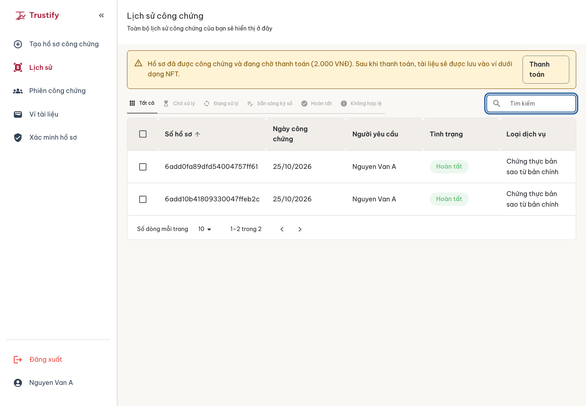

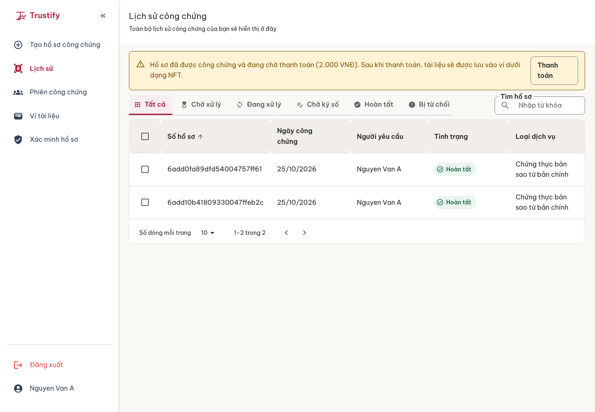

user /user/history — 390px

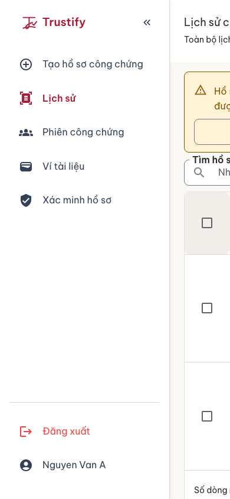

notary /notary/dashboard — 1440px

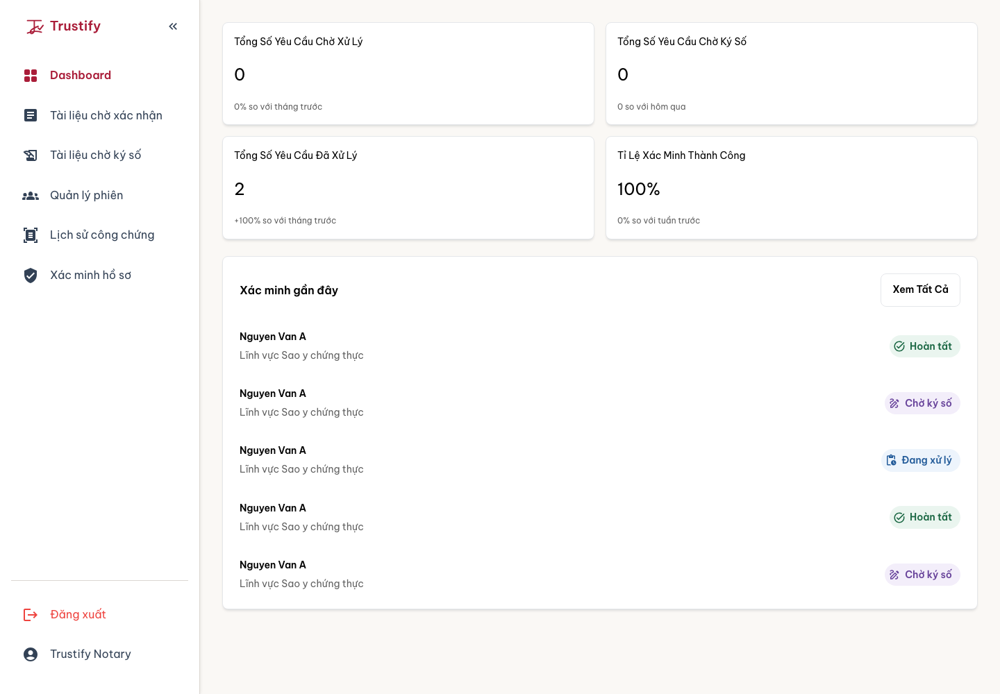

notary /notary/dashboard — 390px

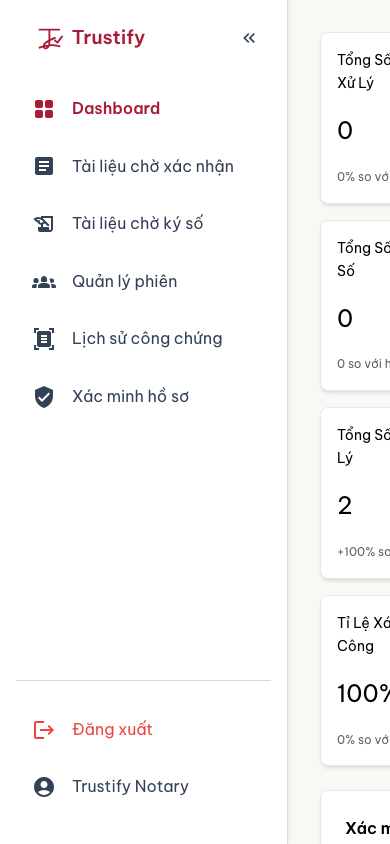

notary /notary/notarization-history — 1440px

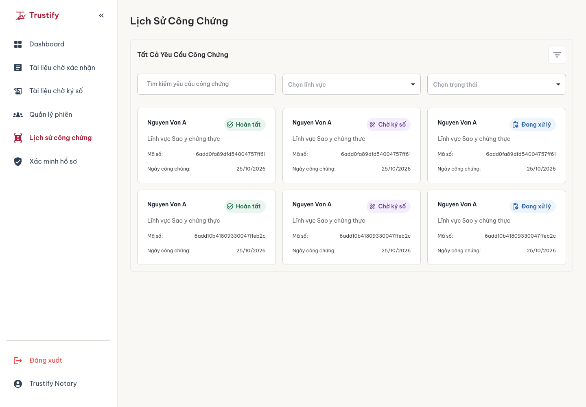

notary /notary/notarization-history — 390px

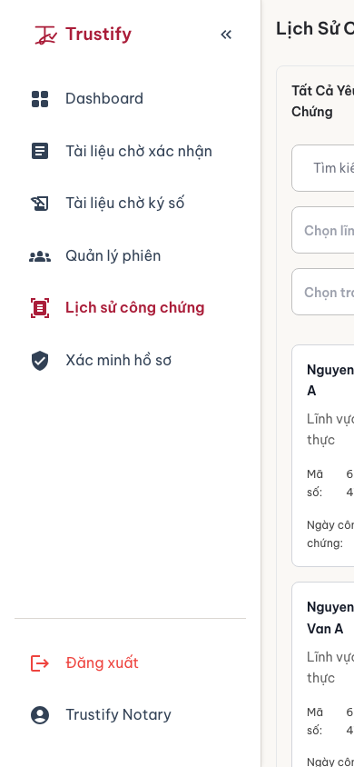

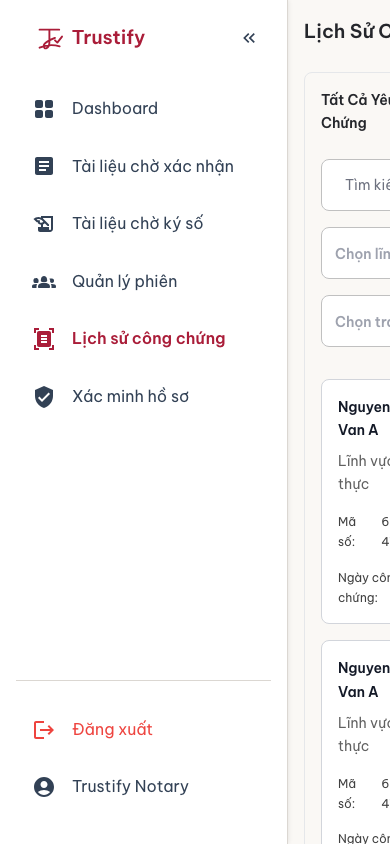

admin /admin/notary-management — 1440px

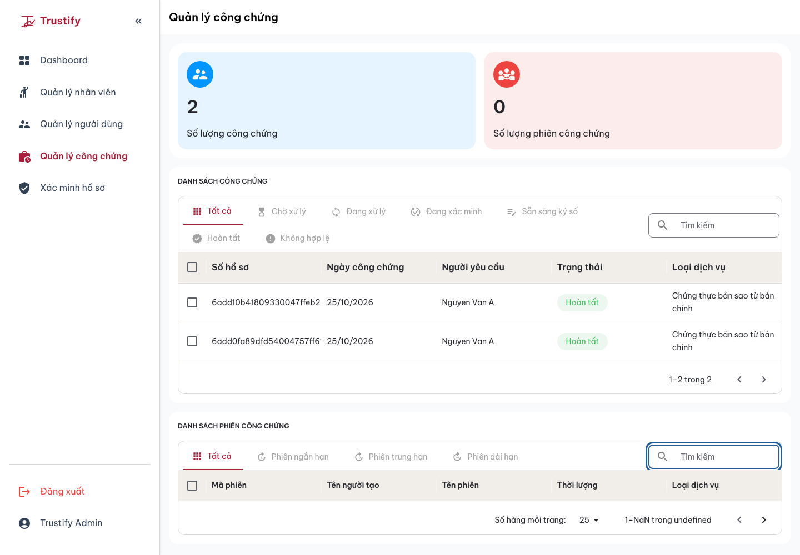

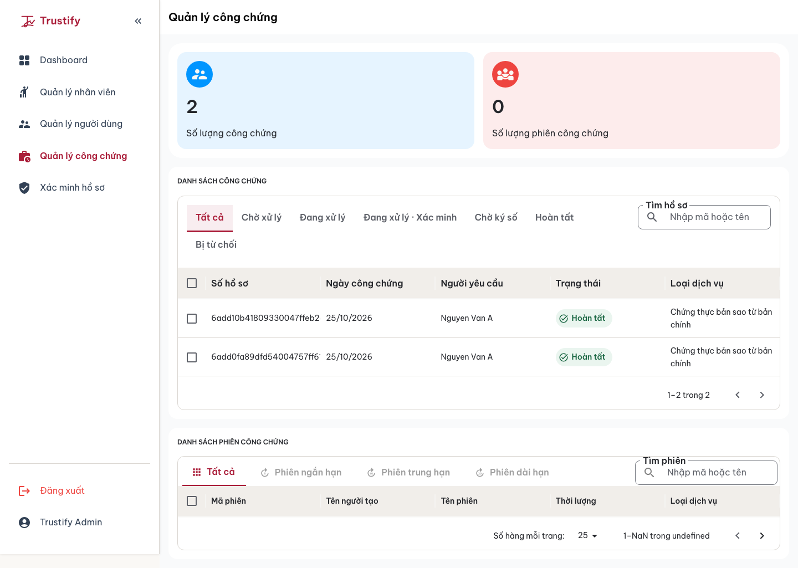

admin /admin/notary-management — 390px

## Vercel preview captures

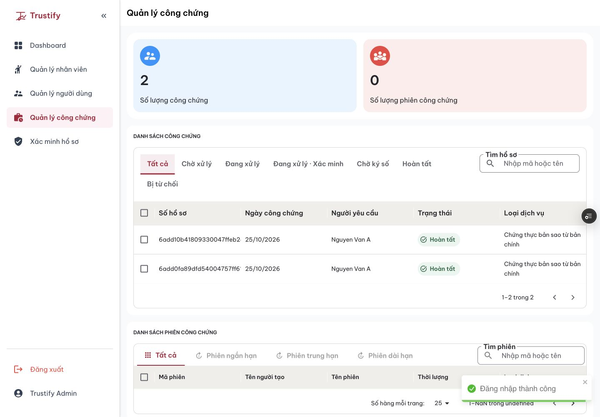

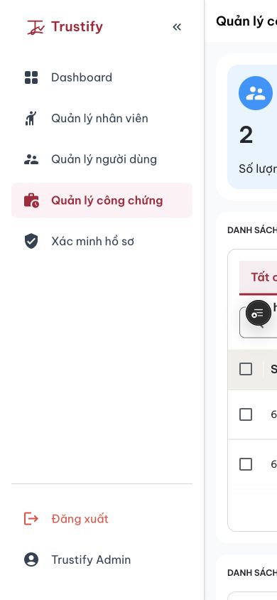

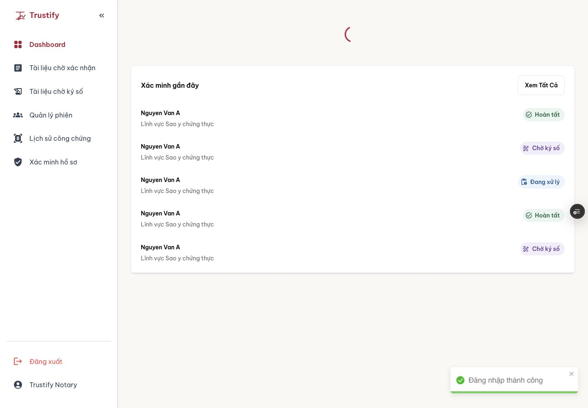

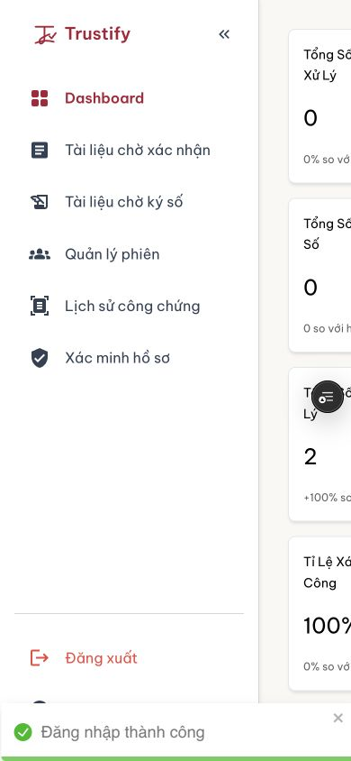

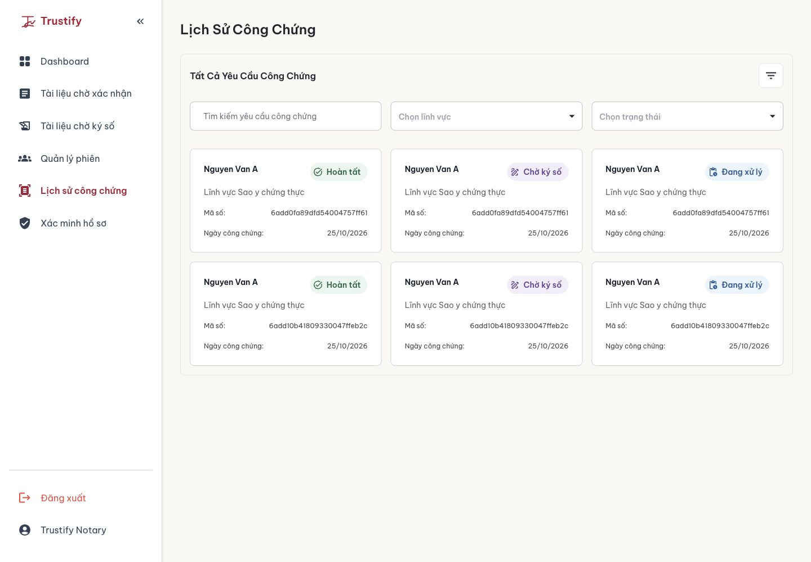

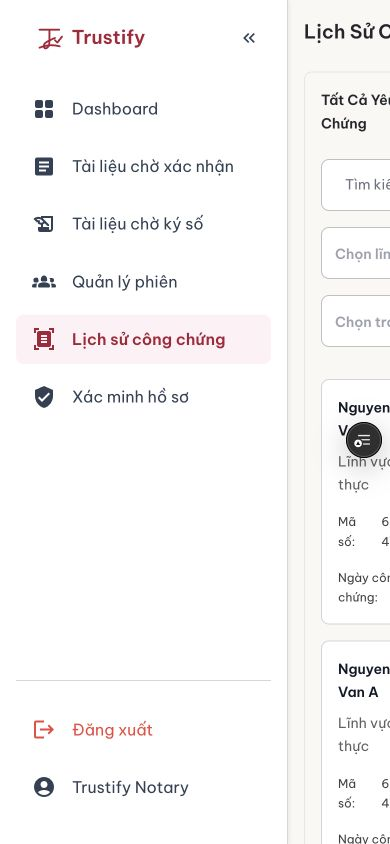

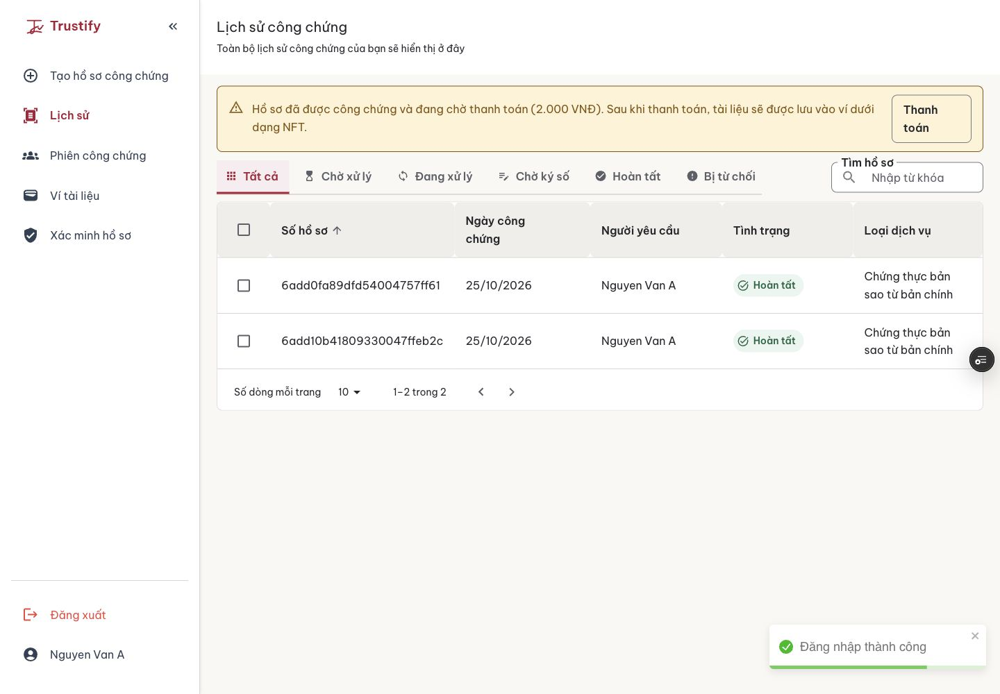

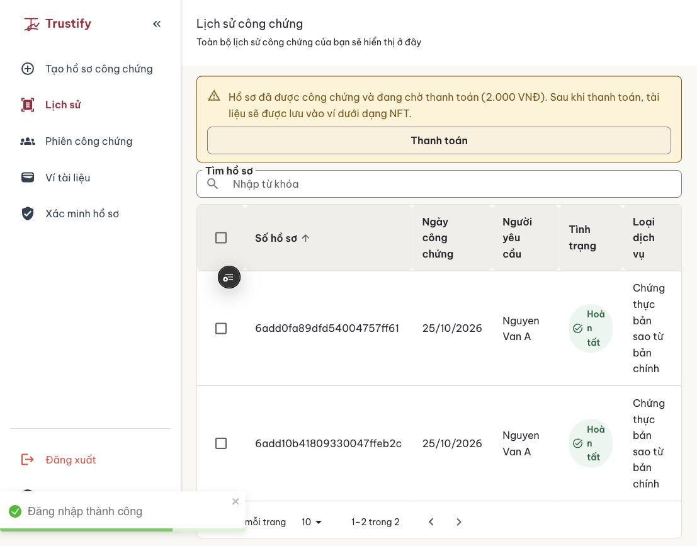

## Claude review — round 1

- Status labels use nowrap; the verification detail is a separate readable line. Status columns have a 140px minimum.
- Removed the chip’s forced top alignment. Browser fixture checks confirm presentation midpoint within 1px of the Admin cell midpoint, with labels fully visible on one line.
- Replaced before/after mobile full-page images with true 390px viewport captures. The previous viewport itself was 390px, but full-page capture included roughly 1100px of overflow. This correction exposes that existing layout limitation instead of portraying it as responsive.
